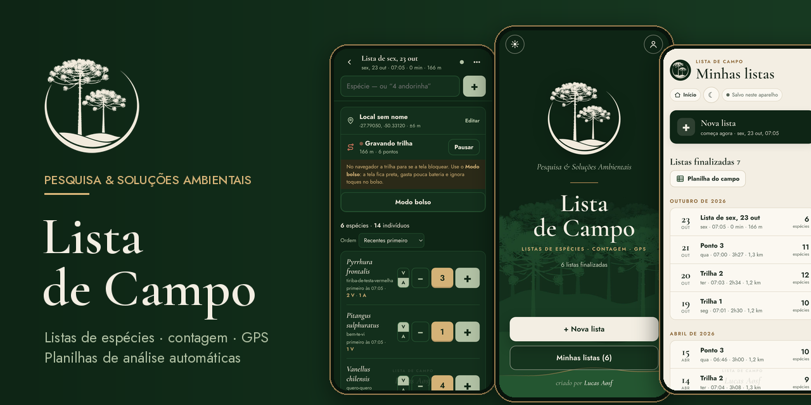
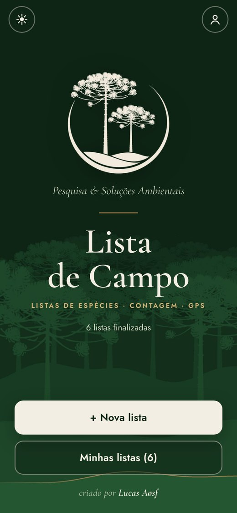
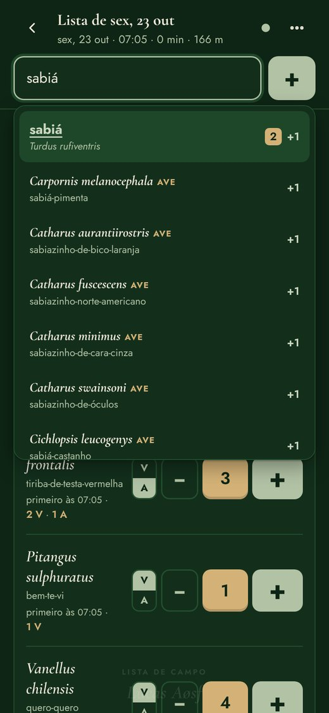
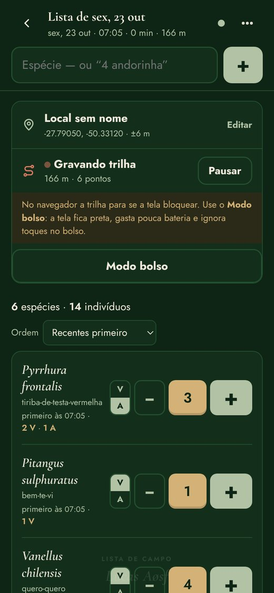
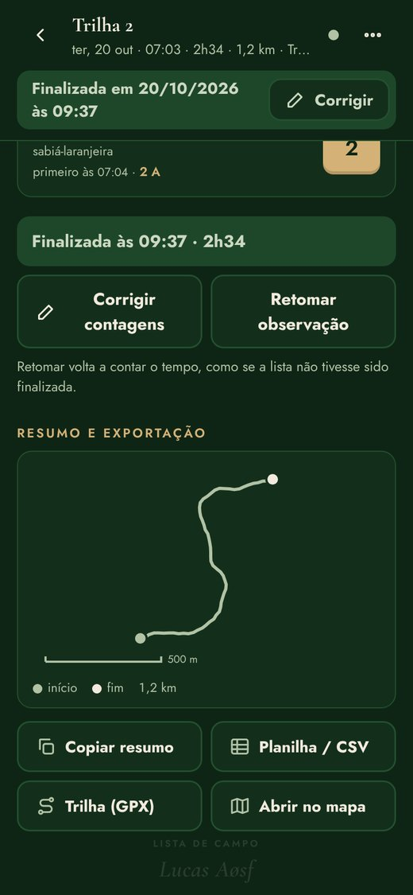
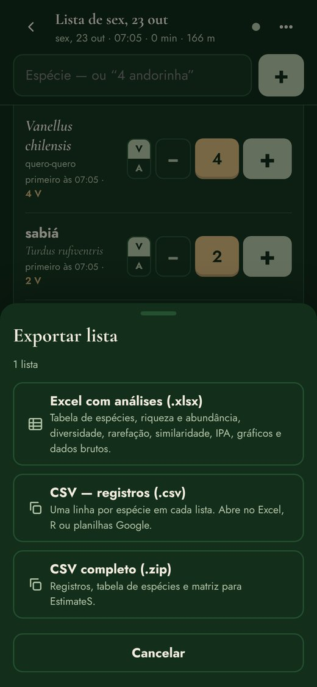
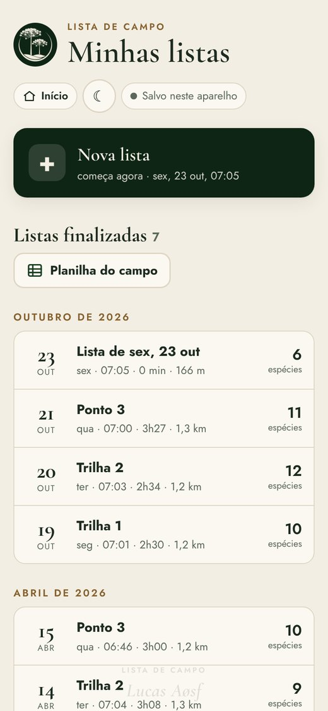
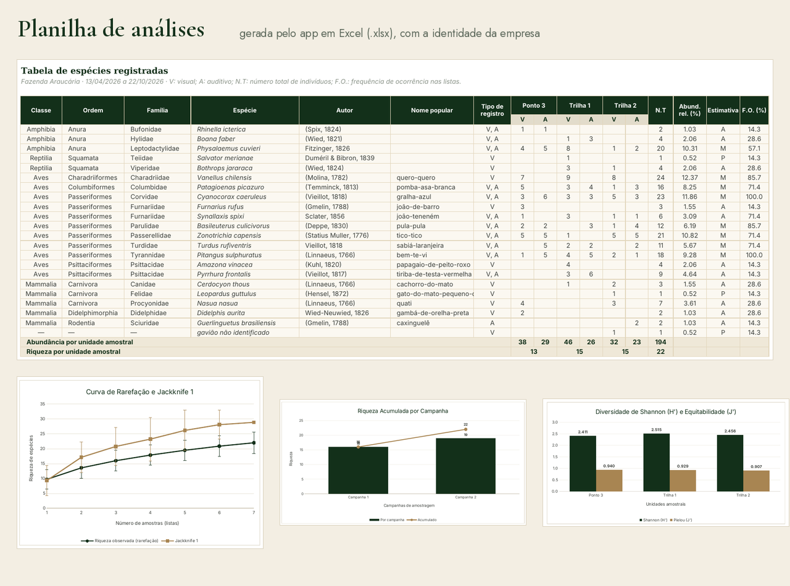

  

# Lista de Campo

App de listas de espécies para o trabalho de campo — **Pesquisa & Soluções Ambientais**, criado por **Lucas Aøsf**.

**[Abrir o app](https://lucasaosf.github.io/caderneta-de-campo/)** · **[Como usar (vídeo e passo a passo)](https://lucasaosf.github.io/caderneta-de-campo/como-usar.html)** · [Política de privacidade](https://lucasaosf.github.io/caderneta-de-campo/privacidade.html)

## Vídeo: como usar

## O que o app faz

- **Banco com 4.903 espécies do Brasil**: mamíferos (SBMz), aves (CBRO), répteis e anfíbios (SBH). Sugestões pelo nome popular ou científico.
- **Apelidos**: cada pessoa cria os seus (“jara” → *Bothrops jararaca*). Na planilha sai sempre o nome científico.
- **Contagem** com − e +, **V** (visual) e **A** (auditivo); “4 quero-quero” já soma 4.
- **Projeto, campanha, unidade amostral e método** em cada lista.
- **Trilha GPS** com distância e mapa do percurso; **modo bolso** no navegador.
- **Exportação** em Excel com análises ou em CSV, por lista ou do campo inteiro, inclusive **cumulativa** entre campanhas.
- **Modo claro e escuro**, funciona **sem internet** e avisa quando há versão nova.

## Telas

<table>
  <tr>
    <td align="center" width="25%"> Capa</td>
    <td align="center" width="25%"> Busca no banco de espécies</td>
    <td align="center" width="25%"> Contagem com V e A</td>
    <td align="center" width="25%"> Apelidos</td>
  </tr>
  <tr>
    <td align="center"> Trilha GPS</td>
    <td align="center"> Excel ou CSV</td>
    <td align="center"> Planilha do campo</td>
    <td align="center"> Modo claro</td>
  </tr>
</table>

## Planilha de análises

Tabela de espécies (autor em coluna separada, nome popular, V/A, abundância relativa, F.O. e informações das listas oficiais), riqueza e abundância por unidade amostral, riqueza acumulada entre campanhas, diversidade (Shannon, Pielou, Simpson, Berger-Parker, Margalef), rarefação com estimadores (Chao 1 e 2, Jackknife 1 e 2), similaridade (Jaccard e Bray-Curtis), IPA, composição, registros e matriz para o EstimateS.

## Instalar

- **Android:** abra o app no **Chrome** e toque em **Instalar app** (ou ⋮ → *Adicionar à tela inicial*).
- **iPhone:** abra o app no **Safari** → **Compartilhar** → *Adicionar à Tela de Início*.

As listas ficam salvas no celular e o app funciona sem internet depois de aberto uma vez.

Dados mostrados nas imagens são de exemplo.
