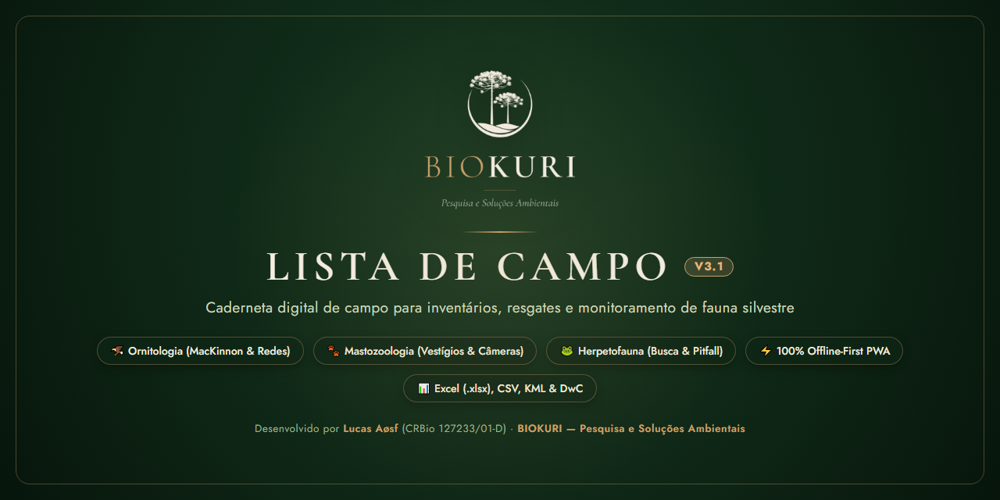
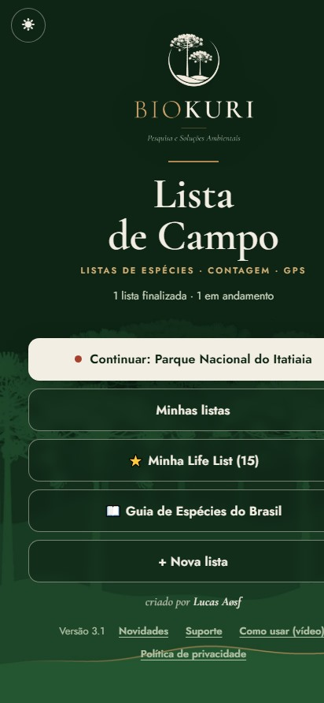
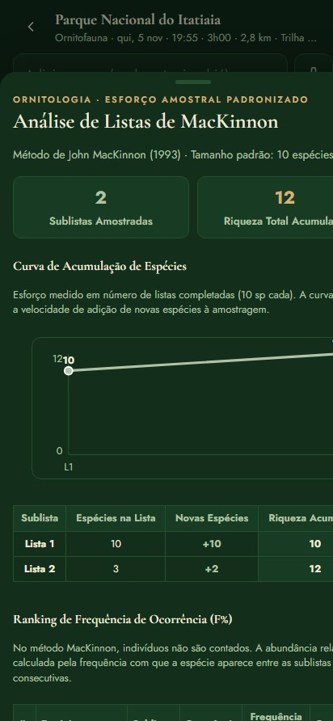
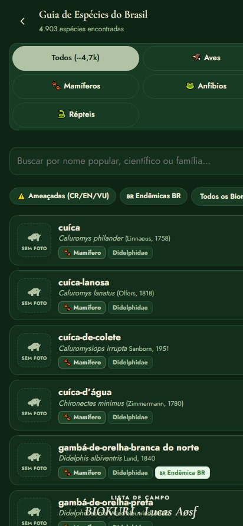
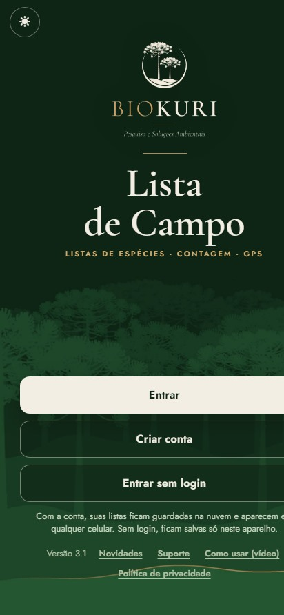
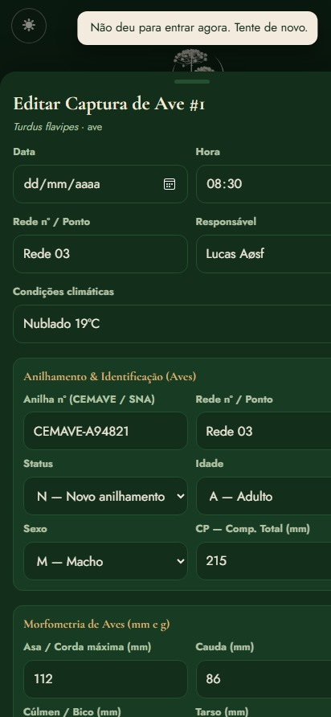
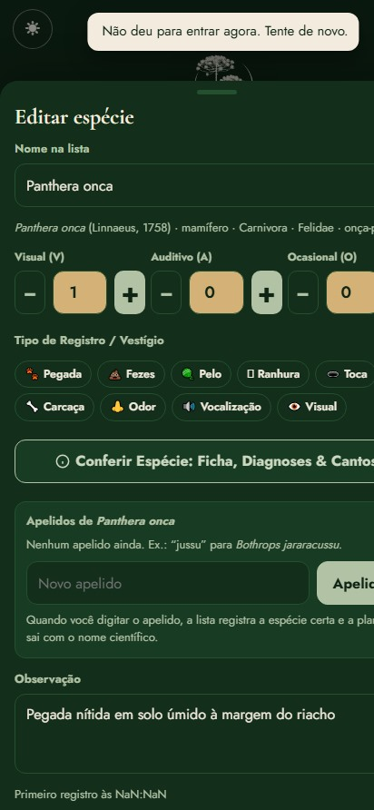
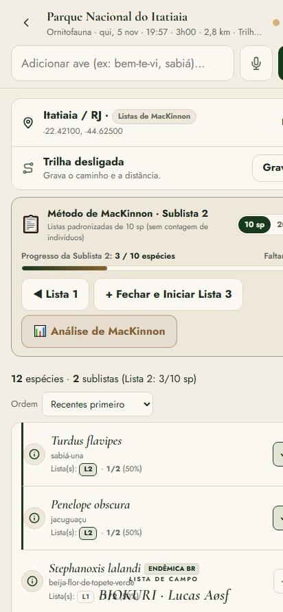
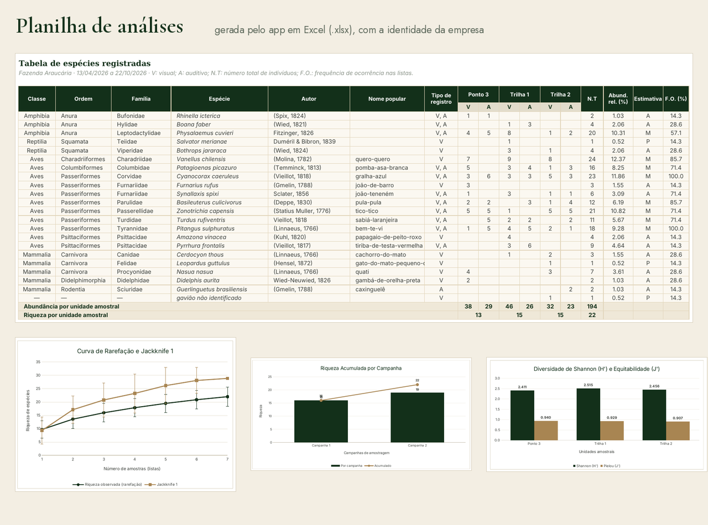

  

  
  
  
  
  

<h1 align="center">Lista de Campo · BIOKURI</h1>

  <b>Caderneta digital de campo para inventários, resgates e monitoramento de fauna silvestre</b> 
  Desenvolvido por <b>Lucas Aøsf</b> · <b>BIOKURI — Pesquisa e Soluções Ambientais</b>

  <a href="https://lucasaosf.github.io/caderneta-de-campo/"><b>🚀 ABRIR O APLICATIVO</b></a> ·
  <a href="https://lucasaosf.github.io/caderneta-de-campo/como-usar.html"><b>📖 Guia de Uso</b></a> ·
  <a href="https://lucasaosf.github.io/caderneta-de-campo/privacidade.html"><b>🔒 Política de Privacidade</b></a>

---

## 🌿 Sobre o Projeto

O **Lista de Campo** é um Progressive Web App (PWA) de alto desempenho, concebido especificamente para substituir pranchetas de papel e cadernetas físicas no trabalho de campo de consultores ambientais, peritos e pesquisadores da biodiversidade. 

Projetado com arquitetura **100% offline-first**, o aplicativo opera com autonomia total em áreas remotas e unidades de conservação sem sinal de internet ou cobertura celular. Conta com um banco taxonômico oficial integrado de **4.903 espécies brasileiras** (aves, mamíferos, répteis e anfíbios), fluxos metodológicos padronizados, análises ecológicas automáticas e exportação multiformato.

---

## ⚡ Principais Recursos & Funcionalidades

### 1. Métodos Amostrais Especializados por Grupo Faunístico
- **Ornitologia (Aves):**
  - **Listas de MacKinnon:** Método padronizado de listas fixas de **10 espécies** ou **20 espécies** sem contagem de indivíduos. Inclui controle de sub-listas consecutivas ($L_1, L_2, L_3 \dots$), avanço automático de lista, barra de progresso em tempo real e análise integrada no app com **Curva do Coletor** (suficiência amostral via SVG) e cálculo de **Frequência de Ocorrência ($F\%$)**.
  - **Rede de Neblina & Anilhamento:** Formulário biométrico de campo completo com código oficial de anilha (SNA / CEMAVE / ICMBio), rede nº, demografia (sexo e idade), morfometria de precisão (comprimento total CP, corda da asa, cauda, cúlmen, tarso e peso), placa de incubação (graus 0 a 3), gordura furcular (escala 0 a 5) e muda de penas.
  - **Transecto** e **Ponto de Escuta**.
- **Mastozoologia (Mamíferos):**
  - **Busca Ativa**, **Câmera Trap** e **Vestígios**.
  - **Chips Rápidos de Vestígios:** Seleção em 1 toque para anexar fezes, pelos, pegadas, ranhuras, tocas, carcaças, odor, vocalizações ou avistamento visual direto.
- **Herpetofauna (Anfíbios e Répteis):**
  - **Busca Ativa**, **Pitfall (Armadilhas de Interceptação e Queda)** e **Busca Ativa + Pitfall**.
  - Biometria completa para anfíbios e répteis: CRC, cauda, peso, biometria cefálica (AC/LC), folidose de serpentes (supralabiais, infralabiais, subcaudais e cloacal).

### 2. Guia de Espécies do Brasil (4.903 Táxons Oficiais)
- Base alinhada às listas vigentes dos comitês científicos nacionais: **CBRO** (Aves), **SBMz** (Mamíferos) e **SBH** (Anfíbios e Répteis).
- **Miniaturas Fotográficas:** Carregamento inteligente com cache local persistente nos cards de espécies para identificação rápida.
- **Silhuetas Anatômicas Vetoriais:** Ícones representativos por grupo taxonômico (ave, mamífero, anfíbio ou réptil) com indicação para espécies sem foto cadastrada.
- **Carrossel de Imagens & Touch Swipe:** Rodagem contínua de fotos de campo com suporte a gestos de deslize na tela do smartphone.
- **Diagnoses Morfológicas Estruturadas:** Caracteres anatômicos diagnósticos (porte, cabeça, textura da pele, escamas, plumagem, pelagem) e chaves diferenciais para não confundir com espécies congêneres semelhantes.
- **Acervo Bioacústico Integrado:** Reprodução instantânea de vocalizações e cantos de campo via Xeno-Canto e coleções científicas.
- **Moderação de Fotos Colaborativas:** Envio de fotografias de campo pelo usuário diretamente para conferência e validação taxonômica do desenvolvedor via e-mail e WhatsApp.

### 3. Mapa Interativo de Distribuição Geográfica com Seleção por Estados (UFs)
- Mapa vetorial do Brasil com seleção tátil direta nos estados (uma ou múltiplas UFs).
- Filtragem dinâmica em tempo real: veja as ocorrências registradas em cada estado, biomas de abrangência e pontos de GPS da própria expedição.

### 4. Referências Bibliográficas em Normas da ABNT (NBR 6023:2018)
- Em conformidade com as exigências de perícias judiciais, laudos técnicos e relatórios de licenciamento ambiental (EIA/RIMA, PCA, PBA).
- Reúne a obra *princeps* de descrição original, checklists nacionais oficiais, estado de conservação (Portaria MMA nº 148/2022 e Livro Vermelho ICMBio), base de dados SiBBr/GBIF e acervos sonoros.
- Botão de **Cópia em 1 Clique** para transferir todas as referências formatadas diretamente para o relatório técnico.

### 5. Gestão de Expedições e Seleção Múltipla por Long-Press
- **Seleção em Lote:** Pressione e segure qualquer lista na tela inicial para ativar o modo de seleção múltipla instantaneamente com a lista já marcada.
- **Exclusão em Lote com Segurança:** Apague várias listas com modal de confirmação e botão de desfazer. Os registros de espécies permanecem preservados na **Life List vitalícia**.
- **Life List Permanente:** Contador histórico de espécies únicas e dias de campo acumulados pelo pesquisador ao longo de sua trajetória profissional.

### 6. Trilha GPS, Modo Bolso e Navegação Offline
- Gravação de percurso com cálculo contínuo de distância percorrida (km) e pontos georreferenciados.
- **Modo Bolso:** Bloqueio sensível ao toque que impede toques acidentais na tela enquanto o celular grava a trilha no bolso durante caminhadas na mata.

### 7. Exportação Multiformato e Relatórios Técnicos
- **Planilha Excel (.xlsx) BIOKURI:** Relatório completo com fórmulas nativas, aba de espécies, registros diários, biometria herpetológica, curvas de rarefação cumulativas, índices de diversidade (Shannon, Simpson, Pielou) e matriz para o EstimateS.
- **CSV & ZIP** para análise quantitativa em R e Python.
- **KML** georreferenciado para visualização no Google Earth.
- **GeoJSON** pronto para SIG (QGIS e ArcGIS).
- **Darwin Core Archive (DwC)** para envio padronizado ao SiBBr e GBIF.
- **Card Infográfico para WhatsApp:** Renderizado em Canvas HD com resumo da amostragem para envio rápido a clientes e equipes de campo.

---

## 📱 Telas do Aplicativo

<table align="center">
  <tr>
    <td align="center" width="33%">
       
      <b>Capa Oficial BIOKURI</b> 
      Identidade visual clássica e navegação rápida
    </td>
    <td align="center" width="33%">
       
      <b>Tela Inicial &amp; Gestão</b> 
      Listas ativas, finalizadas e Life List vitalícia
    </td>
    <td align="center" width="33%">
       
      <b>Listas de MacKinnon (Ornito)</b> 
      Banner interativo, sub-listas e avanço automático
    </td>
  </tr>
  <tr>
    <td align="center" width="33%">
       
      <b>Curva do Coletor no App</b> 
      Suficiência amostral e frequência F% em tempo real
    </td>
    <td align="center" width="33%">
       
      <b>Guia de Espécies do Brasil</b> 
      Miniaturas fotográficas e filtros taxonômicos
    </td>
    <td align="center" width="33%">
       
      <b>Ficha da Espécie &amp; ABNT</b> 
      Diagnose morfológica, carrossel e mapa interativo
    </td>
  </tr>
  <tr>
    <td align="center" width="33%">
       
      <b>Rede de Neblina &amp; Anilhamento</b> 
      Morfometria CEMAVE, placa, gordura e muda
    </td>
    <td align="center" width="33%">
       
      <b>Vestígios de Mamíferos</b> 
      Chips rápidos: pegada, fezes, pelo, ranhura, toca
    </td>
    <td align="center" width="33%">
       
      <b>Modo Claro (Tema Clássico)</b> 
      Excelente legibilidade sob luz solar intensa
    </td>
  </tr>
</table>

---

## 📊 Planilha Técnica de Análises (.xlsx)

  

A planilha gerada pelo aplicativo atende a todos os critérios e padrões exigidos pelos órgãos ambientais (IBAMA, ICMBio e órgãos estaduais):
- **Aba Resumo:** Cabeçalho institucional **BIOKURI**, metadados da expedição, esforço amostral e KPIs ecológicos gerais.
- **Aba Espécies:** Listagem com autoridade taxonômica em coluna própria, nome popular, contagens V/A, abundância relativa, F.O. e status de conservação (IUCN, MMA, CITES).
- **Aba Registros (Campo):** Tabela diária com carimbo de data/hora, coordenadas de GPS, tipo de registro, método e observações ecológicas.
- **Aba Biometria:** Ficha morfométrica completa para herpetofauna de pitfall (CRC, cauda, peso, folidose) e aves de rede.
- **Abas Ecológicas:** Riqueza e abundância por UA, diversidade (Shannon, Simpson, Pielou, Margalef), rarefação (Chao 1 e 2, Jackknife 1 e 2), similaridade (Jaccard e Bray-Curtis) e matriz de incidência para o EstimateS.

---

## 📲 Como Instalar e Usar

O **Lista de Campo** é um PWA leve que não consome espaço na memória do aparelho e não exige download via lojas de aplicativos:

1. **No Android (Google Chrome):**
   - Acesse **[https://lucasaosf.github.io/caderneta-de-campo/](https://lucasaosf.github.io/caderneta-de-campo/)**
   - Toque no aviso **"Instalar aplicativo"** no rodapé (ou menu `⋮` → **Adicionar à tela inicial**).
2. **No iPhone / iPad (Safari):**
   - Acesse o link no Safari.
   - Toque no botão de **Compartilhar** (`Compartilhar`) → **Adicionar à Tela de Início**.

> [!TIP]
> Uma vez aberto pela primeira vez, o aplicativo e todo o seu banco taxonômico de 4.903 espécies ficam salvos localmente no dispositivo via Service Worker. Você pode utilizá-lo normalmente em modo avião ou em florestas sem sinal.

---

## 👨‍🔬 Autoria & Responsabilidade Técnica

- **Autor e Desenvolvedor:** Lucas Aøsf
- **Empresa:** **BIOKURI — Pesquisa e Soluções Ambientais**
- **Contato Direto:** `lucasaosf@gmail.com` · Cel/WhatsApp: `+55 (12) 99182-1729`
- **Redes:** Instagram [@lucas_aosf](https://instagram.com/lucas_aosf)

---

  BIOKURI — Pesquisa e Soluções Ambientais · Todos os direitos reservados.

